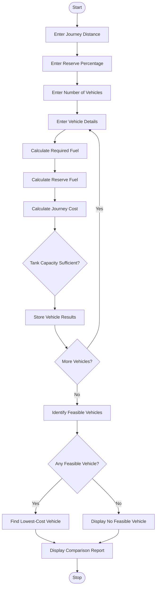

# Fuel-Consumption
# Fuel Consumption and Route Comparison System

## 1. Project Overview

The Fuel Consumption and Route Comparison System is a Python-based application that compares fuel consumption and journey costs for multiple vehicles.

The system calculates the fuel required for a given journey distance using vehicle mileage, fuel prices, and reserve fuel requirements. It also checks whether each vehicle has sufficient fuel tank capacity and identifies the lowest-cost feasible vehicle.

## 2. Problem Statement

Different vehicles have different mileage, fuel prices, and fuel tank capacities. Selecting the most economical vehicle for a journey requires comparing fuel consumption and total travel expenses.

This project provides an automated solution to calculate fuel requirements, journey costs, reserve fuel, and vehicle feasibility.

## 3. Objectives

- Calculate fuel requirements based on journey distance.
- Compare mileage across multiple vehicles.
- Calculate journey costs using fuel prices.
- Include additional reserve fuel requirements.
- Check vehicle fuel tank capacity.
- Identify feasible vehicles.
- Find the lowest-cost feasible vehicle.
- Display a detailed comparison report.

## 4. Technologies Used

- Programming Language: Python
- Concepts: Variables, Lists, Dictionaries, Functions, Loops, Conditional Statements
- Exception Handling: try-except
- Built-in Functions: min(), float(), int()

## 5. Assumptions

1. All vehicles travel the same journey distance.
2. Vehicle mileage is provided in kilometres per litre (km/l).
3. Fuel prices are entered in rupees per litre.
4. The fuel tank is assumed to be full at the beginning of the journey.
5. Reserve fuel is calculated as a percentage of journey fuel consumption.
6. A vehicle is feasible only if its tank capacity is sufficient for journey fuel plus reserve fuel.
7. Journey cost is calculated using the fuel consumed during the journey, excluding unused reserve fuel.
8. The vehicle with the lowest journey cost among feasible vehicles is selected.
9. All input values must be positive, except reserve percentage, which can be zero.

## 6. Algorithm

1. Start the program.
2. Enter the total journey distance.
3. Enter the required reserve fuel percentage.
4. Enter the number of vehicles.
5. For each vehicle:
   - Enter vehicle name.
   - Enter mileage.
   - Enter fuel price per litre.
   - Enter fuel tank capacity.
6. Calculate fuel required using:

   Fuel Required = Distance / Mileage

7. Calculate reserve fuel:

   Reserve Fuel = Fuel Required × Reserve Percentage / 100

8. Calculate total fuel requirement:

   Total Fuel = Fuel Required + Reserve Fuel

9. Calculate journey cost:

   Journey Cost = Fuel Required × Fuel Price

10. Check whether total fuel requirement is within tank capacity.
11. Store the vehicle details and calculated results.
12. Compare all feasible vehicles.
13. Identify the vehicle with the lowest journey cost.
14. Display the comparison report and final result.
15. Stop the program.

## 7. Pseudocode

```text
START

INPUT journey_distance
INPUT reserve_percentage
INPUT number_of_vehicles

CREATE empty vehicle list

FOR each vehicle

    INPUT vehicle_name
    INPUT mileage
    INPUT fuel_price
    INPUT tank_capacity

    fuel_required = distance / mileage

    reserve_fuel =
        fuel_required * reserve_percentage / 100

    total_fuel =
        fuel_required + reserve_fuel

    journey_cost =
        fuel_required * fuel_price

    IF total_fuel <= tank_capacity
        status = FEASIBLE
    ELSE
        status = NOT FEASIBLE
    END IF

    STORE vehicle details and results

END FOR

FIND feasible vehicles

IF feasible vehicles exist

    FIND vehicle with minimum journey cost

    DISPLAY lowest-cost vehicle

ELSE

    DISPLAY no feasible vehicle found

END IF

DISPLAY comparison results

STOP
```

## 8. Flowchart



## 9. Test Cases

| Test | Vehicle | Distance | Mileage | Fuel Price | Tank Capacity | Expected Status |
|---|---|---:|---:|---:|---:|---|
| 1 | Car | 300 km | 15 km/l | ₹105 | 50 L | Feasible |
| 2 | Bike | 300 km | 40 km/l | ₹105 | 12 L | Feasible |
| 3 | SUV | 300 km | 10 km/l | ₹105 | 25 L | Not Feasible |
| 4 | Bus | 500 km | 5 km/l | ₹100 | 80 L | Not Feasible |
| 5 | Truck | 200 km | 8 km/l | ₹100 | 40 L | Feasible |
| 6 | Car | 100 km | 20 km/l | ₹105 | 1 L | Not Feasible |

**Reserve fuel percentage for these test cases: 10%.**

## 10. Sample Output

```text
==================================================
 FUEL CONSUMPTION AND ROUTE COMPARISON
==================================================

Enter journey distance (km): 300
Enter required fuel reserve (%): 10

Enter number of vehicles: 3

--- Vehicle 1 Details ---
Enter vehicle name: Car
Enter mileage (km/l): 15
Enter fuel price per litre: 105
Enter fuel tank capacity: 50

--- Vehicle 2 Details ---
Enter vehicle name: Bike
Enter mileage (km/l): 40
Enter fuel price per litre: 105
Enter fuel tank capacity: 12

--- Vehicle 3 Details ---
Enter vehicle name: SUV
Enter mileage (km/l): 10
Enter fuel price per litre: 105
Enter fuel tank capacity: 25

========== VEHICLE COMPARISON ==========

Vehicle: Car
Journey Fuel: 20.00 litres
Reserve Fuel: 2.00 litres
Total Fuel Needed: 22.00 litres
Tank Capacity: 50.00 litres
Journey Cost: Rs. 2100.00
Status: FEASIBLE

Vehicle: Bike
Journey Fuel: 7.50 litres
Reserve Fuel: 0.75 litres
Total Fuel Needed: 8.25 litres
Tank Capacity: 12.00 litres
Journey Cost: Rs. 787.50
Status: FEASIBLE

Vehicle: SUV
Journey Fuel: 30.00 litres
Reserve Fuel: 3.00 litres
Total Fuel Needed: 33.00 litres
Tank Capacity: 25.00 litres
Journey Cost: Rs. 3150.00
Status: NOT FEASIBLE

========== FINAL RESULT ==========

Lowest-Cost Feasible Vehicle: Bike
Fuel Required: 7.50 litres
Journey Cost: Rs. 787.50
```

## 11. Conclusion

The Fuel Consumption and Route Comparison System successfully calculates fuel requirements and journey costs for multiple vehicles.

It considers vehicle mileage, fuel prices, reserve requirements, and fuel tank capacity to determine vehicle feasibility.

The system identifies the lowest-cost feasible vehicle, helping users make economical travel decisions.

This project demonstrates the practical application of Python programming concepts in solving real-world fuel consumption and cost comparison problems.

## 12. Project Structure

```text
Fuel-Consumption-Route-Comparison/
│
├── fuel_comparison.py
├── README.md
│
└── Screenshots/
    ├── output1.png
    ├── output2.png
    └── output3.png
```

## 13. How to Run the Project

1. Install Python 3.
2. Open the project folder in VS Code.
3. Open the terminal.
4. Execute the following command:

```bash
python fuel_comparison.py
```

5. Enter the journey distance and reserve percentage.
6. Enter the details of each vehicle.
7. View the vehicle comparison and lowest-cost result.

---

**Project Title:** Fuel Consumption and Route Comparison
name:sree hasini
section:5 

**Programming Language:** Python

**Project Type:** Python Activity-Based Learning
